# ICT 2026 新手完整课程笔记

> 来源：[Easiest Way To Trade ICT in 2026 as a Beginner (2 Hours)](https://www.youtube.com/watch?v=HC2iUkI8Dh8)  
> 依据：用户提供的完整英文字幕与 SRT 时间轴  
> 说明：下文是“视频观点整理＋学习提示”，不是投资建议。正文同时包含 **6 张自绘教学图** 与 **27 张原视频关键截图**；视频截图的标题均标注了可点击的时间戳。

<!-- more -->

## 先把整门课压缩成一句话

**不要先猜当天涨跌；先标出高概率“流动性会被取用”的位置，再等价格来到关键位置后出现操纵、位移与结构确认，最后把止损放在可证伪的位置，并朝下一个未被取用的流动性目标管理交易。**

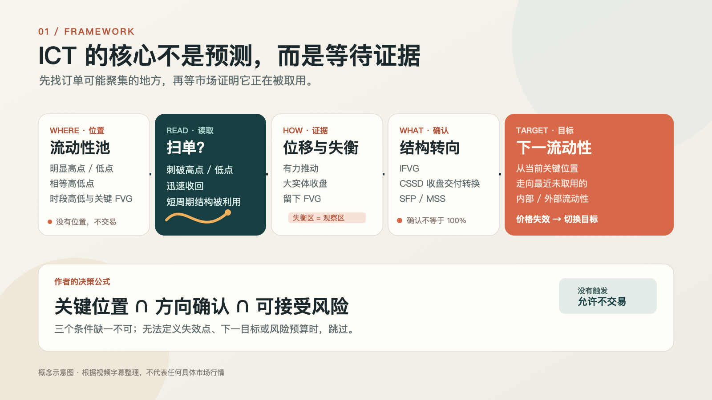

作者把整套方法归纳为三个问题：

1. **Where——在哪里交易？**  
   前一交易日高低点、亚洲/伦敦时段高低点、1H/4H/日线摆动点、公允价值缺口、订单块等。
2. **What——在这些位置等什么？**  
   等流动性扫单、位移、收盘价失衡、倒置公允价值缺口或订单块反应。
3. **When——什么时候交易？**  
   先等关键位置被触及；再看更低周期是否出现确认；作者的日内示例通常在纽约时间 09:30 后才允许执行。

最终，所有分析都被压缩成一句口诀：

> **关键位置（Key Levels）＋确认（Confirmation）＝交易；只有其中一项，就是猜。**

---

## 目录

- [0. 全片逻辑地图](#0-全片逻辑地图)
- [1. ICT 的世界观：流动性、聪明钱与被困交易者](#1-ict-的世界观流动性聪明钱与被困交易者)
- [2. 蜡烛、摆动高低点与市场结构](#2-蜡烛摆动高低点与市场结构)
- [3. Premium / Discount：在贵处卖、在便宜处买](#3-premium--discount在贵处卖在便宜处买)
- [4. 内部与外部流动性：价格如何从一个池子走向另一个池子](#4-内部与外部流动性价格如何从一个池子走向另一个池子)
- [5. 六类关键价位](#5-六类关键价位)
- [6. SMT 背离：用相关市场寻找不同步](#6-smt-背离用相关市场寻找不同步)
- [7. Market Maker Model：把高周期一笔行情拆成低周期路径](#7-market-maker-model把高周期一笔行情拆成低周期路径)
- [8. 交易系统：SOP 比“看对方向”更重要](#8-交易系统sop-比看对方向更重要)
- [9. 盘前、场景规划与新闻风险](#9-盘前场景规划与新闻风险)
- [10. 确认、反转与 Flip](#10-确认反转与-flip)
- [11. 风险管理](#11-风险管理)
- [12. 作者的 All-in-One 机械交易流程](#12-作者的-all-in-one-机械交易流程)
- [13. 目标位与 Price Weighting：让盈利单继续跑](#13-目标位与-price-weighting让盈利单继续跑)
- [14. 交易心理与长期进步](#14-交易心理与长期进步)
- [15. 一页速查表](#15-一页速查表)
- [16. 术语表](#16-术语表)
- [17. 如何批判性地使用这套内容](#17-如何批判性地使用这套内容)

---

## 0. 全片逻辑地图

| 时间 | 章节 | 核心问题 | 学完应能做什么 |
|---|---|---|---|
| 00:00 | 课程目标与成绩声明 | 为什么会“学很多 ICT 却不会交易” | 知道要减少概念、建立机械流程 |
| 02:23 | ICT 基本世界观 | 为什么价格会找高点或低点 | 看懂买卖侧流动性及被困订单 |
| 07:04 | 蜡烛、摆动点 | 如何定义最基本的市场结构 | 标出摆动高低点与失衡 |
| 09:02 | 被困交易者 | 止损与突破单如何成为燃料 | 推断高概率目标方向 |
| 11:45 | 市场结构 | 什么样突破才算“有效” | 用位移与 FVG 过滤假高低点 |
| 16:09 | Premium / Discount | 回撤到哪里更值得关注 | 用 0.5 中位线判断折价或溢价 |
| 19:30 | 周期配合 | 高低周期如何对齐 | 让高周期定背景、低周期定时点 |
| 22:14 | IRL / ERL | 价格为何总在两个池子间移动 | 判断“从哪来、要去哪” |
| 27:36 | 关键价位 | 哪些 FVG、订单块值得交易 | 只做有结构与目标语境的价位 |
| 40:41 | 时间流动性与 SMT | 怎样机械过滤大量高低点 | 用日/周/时段与相关市场筛选 |
| 45:03 | Market Maker Model | 如何不被中继结构甩下车 | 用低周期确认持有至外部流动性 |
| 50:38 | SOP 与策略 | 为什么知道不等于能执行 | 区分交易流程与入场模型 |
| 56:36 | 盘前与新闻 | 每天开盘前准备什么 | 标位置、看事件、做场景 |
| 1:10:44 | 确认与 Flip | 错了以后怎样处理 | 区分反转与水平位失效后的翻转 |
| 1:25:25 | 风险管理 | 怎样避免正确策略仍爆仓 | 规定单笔、单日与连续亏损上限 |
| 1:32:04 | All-in-One 流程 | 如何把全部概念合成六步 | 机械执行作者版本 |
| 1:51:20 | Price Weighting | 如何避免过早止盈 | 用摆动点移动止损让利润奔跑 |
| 1:55:26 | 交易心理 | 如何降低“必须成功”的压力 | 把重点从结果转为过程 |

---

## 1. ICT 的世界观：流动性、聪明钱与被困交易者

### 1.1 作者所说的“聪明钱”

作者把“聪明钱”定义为大型市场参与者，例如银行、机构、对冲基金。他的核心叙事是：

- 大型订单需要足够多的对手盘，不能凭空成交；
- 明显高低点、趋势线、相等高低点、整数关口附近，会聚集止损单和突破单；
- 因此这些位置像“流动性磁铁”，价格会被吸引去取用订单；
- 大资金可能先制造假突破，拿到对手盘，再推动真正的行情。

这是一种解释价格行为的市场微观结构叙事，不是说所有行情都能被证明由某个“庄家”操控。

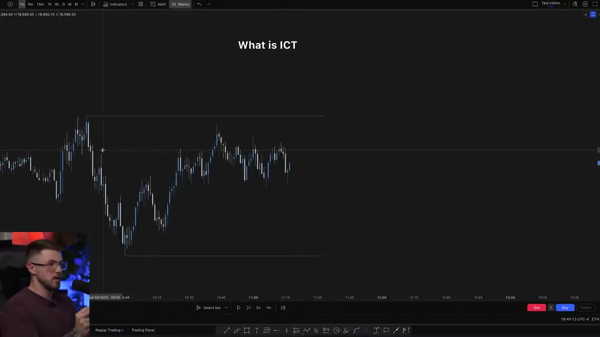

*视频截图｜[03:00](https://www.youtube.com/watch?v=HC2iUkI8Dh8&t=180s)：先看区间上下沿与价格反应，而不是先猜方向。*

### 1.2 Buy-side Liquidity 与 Sell-side Liquidity

**Buy-side Liquidity（买方流动性）**

- 位于明显高点、区间上沿、相等高点之上；
- 空头止损需要买入平仓；
- 突破交易者也可能在相同位置买入；
- 看似“突破做多”的地方，常常同时是卖方理想的出货区。

**Sell-side Liquidity（卖方流动性）**

**位于明显低点、区间下沿、相等低点之下；**

- 多头止损需要卖出平仓；
- 突破做空者也可能在相同位置卖出；
- 看似“跌破做空”的地方，常常同时是买方理想的吸货区。

作者的逻辑可以写成：

> 高点上方的买入单能帮助大额卖单成交；低点下方的卖单能帮助大额买单成交。

### 1.3 “Trapped Traders” 为什么重要

如果很多人在高点上方追多，随后价格快速跌破结构，这些多头就变成被困仓位。每触发一层止损，就产生额外卖压。

反过来，在低点下方追空的人一旦被“扫损后反转”，回补空头就会成为推升价格的燃料。

因此作者要求反复问：

> **谁买在了不该买的位置？谁的止损正在给下一段行情提供燃料？**

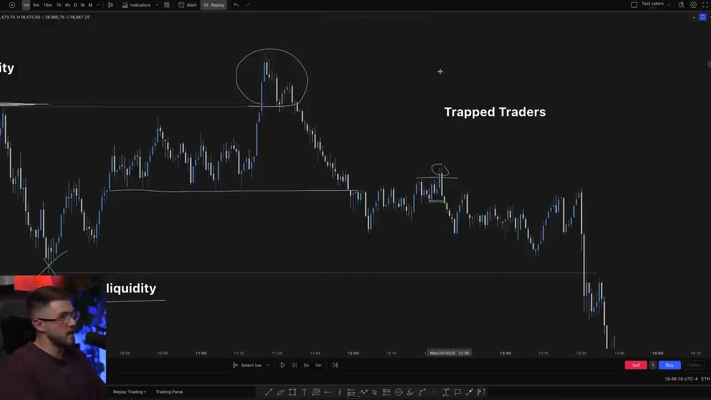

*视频截图｜[09:05](https://www.youtube.com/watch?v=HC2iUkI8Dh8&t=545s)：价格从上方高点快速跌破区间后，追多者与下方追空者分别被套。*

### 1.4 蜡烛和摆动点

蜡烛只回答同一时间窗内的四个问题：

- 最高价；
- 最低价；
- 开盘价；
- 收盘价。

作者的实用定义：

- **Swing High：** 一根蜡烛的高点高于左、右邻柱高点；
- **Swing Low：** 一根蜡烛的低点低于左、右邻柱低点。

这里不需要额外复杂结构确认。先能稳定、机械地标记摆动点，再进一步讨论“哪些摆动点有意义”。

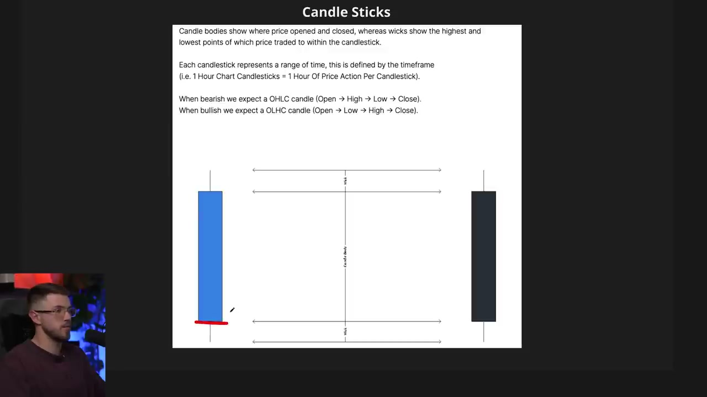

*视频截图｜[07:13](https://www.youtube.com/watch?v=HC2iUkI8Dh8&t=433s)：幻灯片明确区分实体、影线，以及偏空 OHLC 和偏多 OLHC 的典型顺序。*

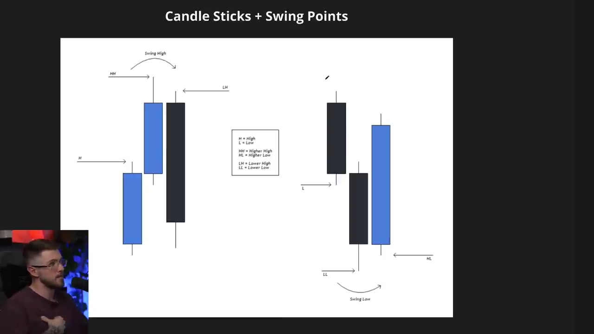

*视频截图｜[08:20](https://www.youtube.com/watch?v=HC2iUkI8Dh8&t=500s)：中间蜡烛的高点高于左右邻柱即为 Swing High；低点反之。*

---

## 2. 蜡烛、摆动高低点与市场结构

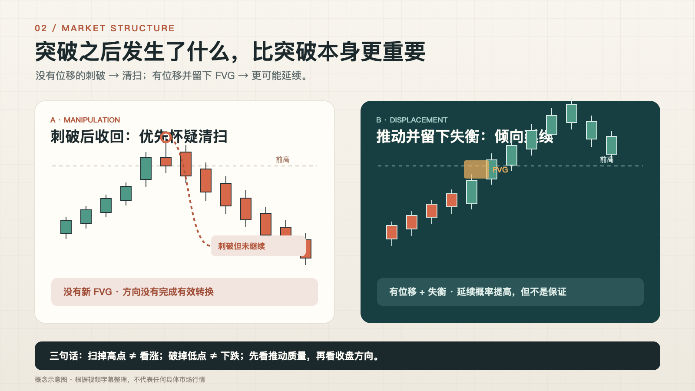

### 2.1 Manipulation 与 Displacement

作者把价格运动分成两种关键状态。

| 概念 | 直观特征 | 作者的解释 | 后续偏向 |
|---|---|---|---|
| Manipulation（操纵） | 突破摆动点后又迅速收回，留下长影线，没有形成有效位移和 FVG | 大资金在关键位置取止损或制造错误预期 | 预期反向 |
| Displacement（位移） | 连续而有力的推动，实体大，常留下 FVG | 没有相反方向资金愿意在该位置接单 | 预期延续 |

简化判断：

- **突破但没有位移，往往是清扫；**
- **突破并留下失衡，才更可能代表方向变化。**

### 2.2 市场结构不是“破前高就一定继续”

作者认为，单纯的“收盘破高低点”容易把清扫误判成趋势：

1. 价格突破前高或前低；
2. 如果没有新一轮位移与 FVG，倾向于把它视为 Manipulation；
3. 真正的 Market Structure Shift 通常伴随快速位移，并改变接下来的价格交付方向。

这并非 ICT 官方唯一标准，而是作者刻意简化后的用法。

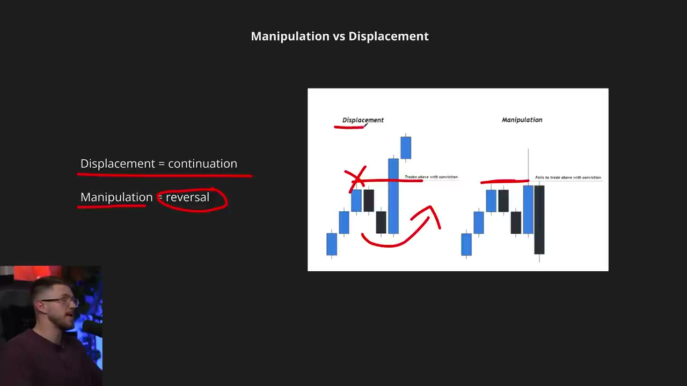

*视频截图｜[13:30](https://www.youtube.com/watch?v=HC2iUkI8Dh8&t=810s)：左边是带信念的连续推动，右边是突破后失败回收。*

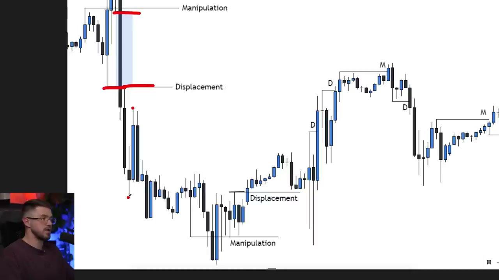

*视频截图｜[14:20](https://www.youtube.com/watch?v=HC2iUkI8Dh8&t=860s)：图中用红线和 M/D 标出了清扫与有效推动的差别。*

### 2.3 Fair Value Gap（FVG）

三根蜡烛形成明显推动时，如果：

- 第 1 根蜡烛的影线与
- 第 3 根蜡烛的影线之间
- 留下没有被第 2 根大实体完全覆盖的价格区间，

就得到作者所说的 Fair Value Gap。

FVG 的含义不是“价格一定返回并反弹”，而是：

- 推动过程太急，成交分布留下缺口；
- 价格回到缺口时，可能寻找迟到的订单；
- 回到缺口后如何处理，才是执行确认。

### 2.4 位移后可以期待什么

作者常用的节奏是：

1. 向下位移并留下 FVG；
2. 默认下一段倾向继续向下；
3. 向上回撤先进入 FVG；
4. 看价格在 FVG 内是否继续制造向上位移；
5. 若不继续向上，而是出现倒置 FVG 或向下价格交付，则寻找空单。

---

## 3. Premium / Discount：在贵处卖、在便宜处买

作者把价格区间类比成商品：

- 想卖，就在 **Premium** 卖；
- 想买，就在 **Discount** 买。

### 3.1 计算方式

使用 Fibonacci 回撤工具时，只保留：

- `1`
- `0.5`
- `0`

从一段有效推动的摆动高点到摆动低点：

- `0.5` 以上：Premium；
- `0.5` 以下：Discount。

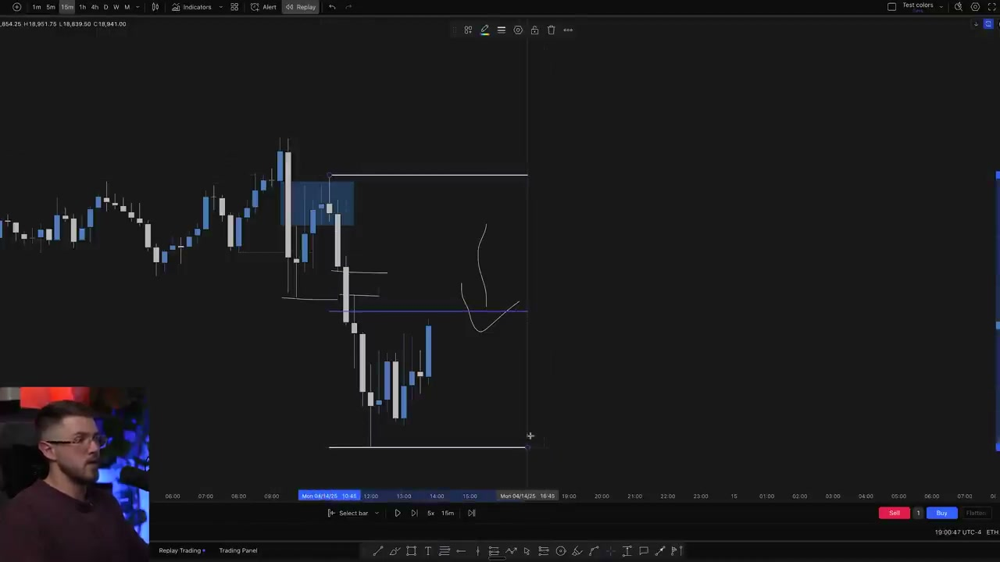

*视频截图｜[17:50](https://www.youtube.com/watch?v=HC2iUkI8Dh8&t=1070s)：作者以新一段推动的高低点为边界，观察回撤是否进入可交易区域。*

### 3.2 怎样使用

若大级别向下位移：

- 偏向做空；
- 优先等回撤进入 Premium 区域；
- 再等低周期出现向下确认。

若大级别向上位移：

- 偏向做多；
- 优先等回撤进入 Discount 区域；
- 再等低周期出现向上确认。

需要注意：

- Premium/Discount 只是位置过滤器，不是入场信号；
- 每次形成新推动后，区间需要重新标记；
- 0.5 中位线是机械参照，不等于绝对价值线。

---

## 4. 内部与外部流动性：价格如何从一个池子走向另一个池子

### 4.1 Internal Range Liquidity（IRL）

作者把区间内部、尤其是推动留下的 FVG，称为内部流动性。

### 4.2 External Range Liquidity（ERL）

区间外部的摆动高低点，代表外部流动性。

作者的循环模型：

1. 价格先扫外部高低点；
2. 向反方向推动，在区间内部留下 FVG；
3. 若方向继续，价格回补内部 FVG；
4. 回补后再次向新的外部高低点扩张；
5. 到达外部目标后，重复下一轮。

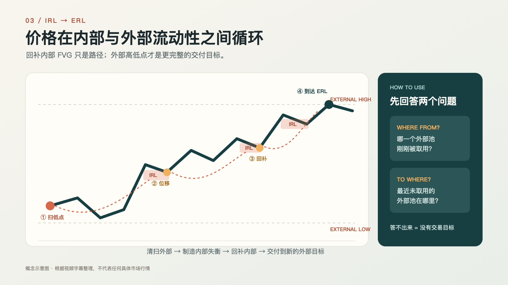

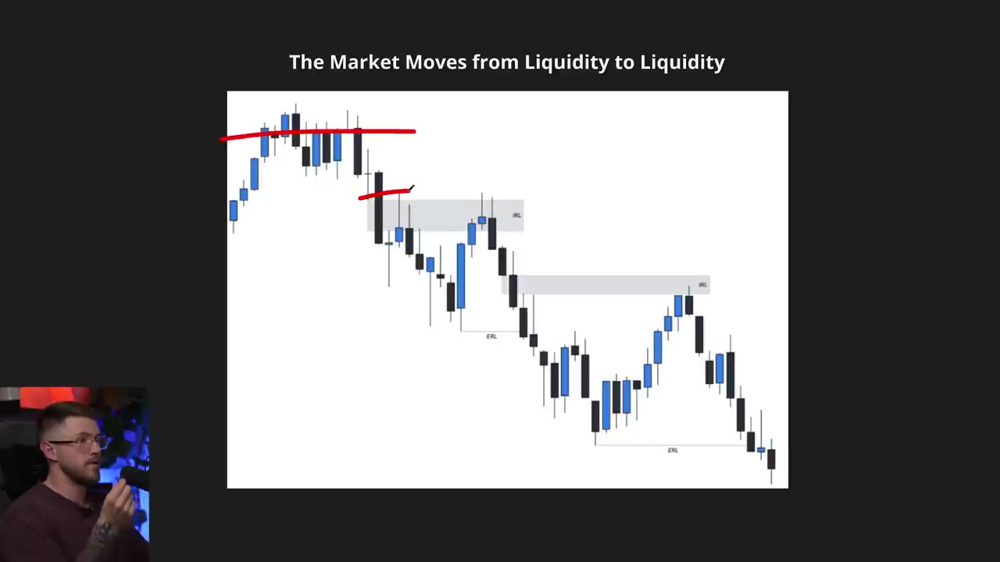

*视频截图｜[23:55](https://www.youtube.com/watch?v=HC2iUkI8Dh8&t=1435s)：内部灰色区域是回补路径，红色曲线标出外部高低点目标。*

### 4.3 时间跨越长时，需要逐级缩小周期

高周期上看到的是一根快速推动；低周期上会包含：

- 回撤；
- 小型假突破；
- 新的 FVG；
- 多次结构转换。

作者的原则：

- 高周期决定“大方向可能去哪里”；
- 低周期决定“现在是否开始走、在哪里入场”；
- 高周期和低周期同时显示同一方向时，才提高信心。

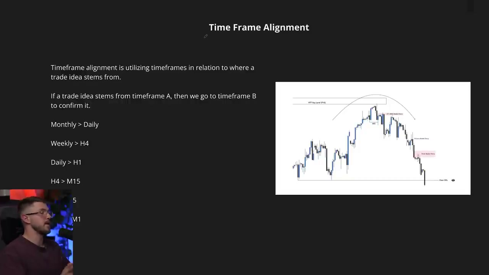

*视频截图｜[19:34](https://www.youtube.com/watch?v=HC2iUkI8Dh8&t=1174s)：Monthly→Daily、Weekly→H4、Daily→H1、H4→M15 等配对用于从背景逐步缩小到执行。*

### 4.4 关于 Bull Flag

作者用 Bull Flag 举例说明：

- 大量散户等待突破后追多；
- 突破处会积累买盘和空头止损；
- 若向上刺破后没有真正向上位移，反而是清扫；
- 此时目标可能转向区间另一侧的卖方流动性。

这里应避免反向推导：**出现 Bull Flag 并不自动意味着会诱多，仍要看关键位置、位移和目标。**

---

## 5. 六类关键价位

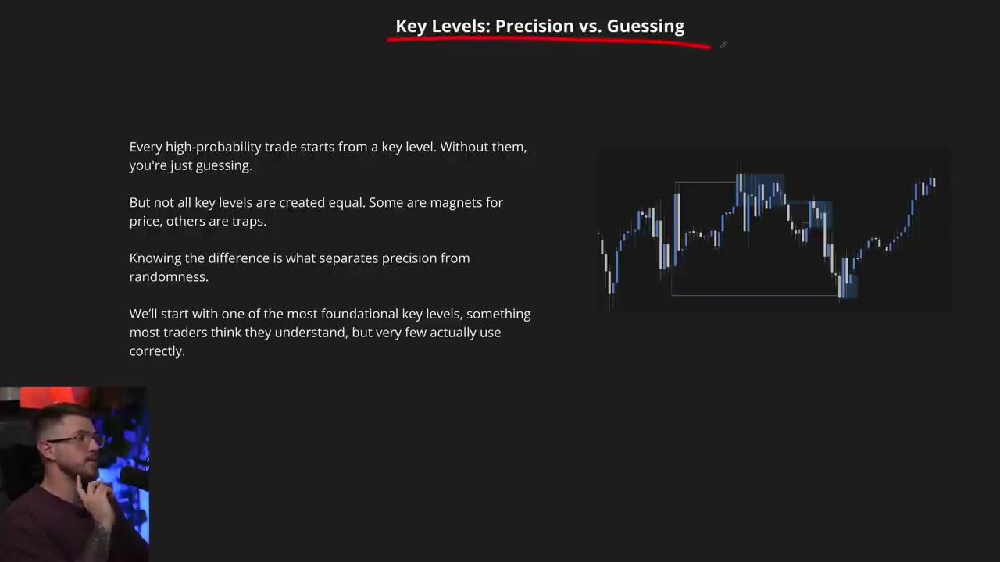

*视频截图｜[27:40](https://www.youtube.com/watch?v=HC2iUkI8Dh8&t=1660s)：幻灯片把“关键位置”与“随便画线”的差别放在整段课程的中心。*

### 5.1 Break in Structure Gap（BOS Gap）

作者认为最有价值的 FVG 之一，不只是“越大越好”，而是：

- 一口气突破多个摆动低/高点；
- 代表大量原本可能接单的位置都被快速穿透；
- 突破过程中留下大 FVG。

这种 FVG 代表反方资金没有成功防守，趋势延续概率更高。

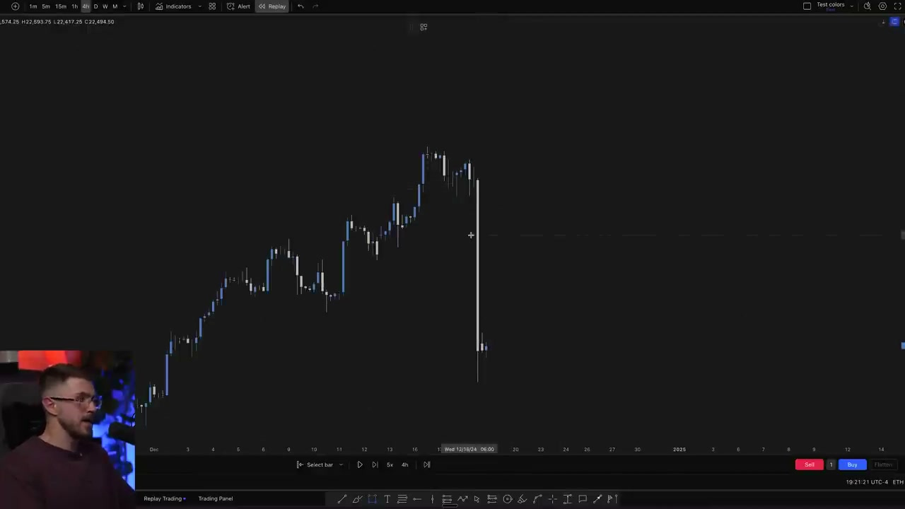

*视频截图｜[29:24](https://www.youtube.com/watch?v=HC2iUkI8Dh8&t=1764s)：图中巨大的下行推动同时穿透多段结构，作者随后用 FVG 寻找回踩位置。*

### 5.2 Inflection Point（IP）

这是作者自行命名的辅助概念，不应当当作 ICT 官方术语。

其思路是：

- 向下快速推动时，一些交易者沿破位连续追空；
- 这些人的入场价集中在 FVG 内；
- 当价格后来回到这些位置，迟到空头可能回补；
- 因此 FVG 内的某些“入场聚集区”可能比整个 FVG 更精确。

用法是缩小观察区，而不是把 FVG 内的每个点都当成支撑阻力。

### 5.3 Inverted Fair Value Gap（IFVG）

看涨 FVG 失效并向下被连续收盘穿透，或看跌 FVG 失效并向上被穿透，可视为 FVG 倒置。

作者的用法：

- 价格先来到真正有意义的关键位置；
- 在低周期出现 IFVG；
- 这表示原本预期的回踩承接失败；
- 可按失效方向寻找入场。

**IFVG 本身不是信号；必须发生在关键位置。**

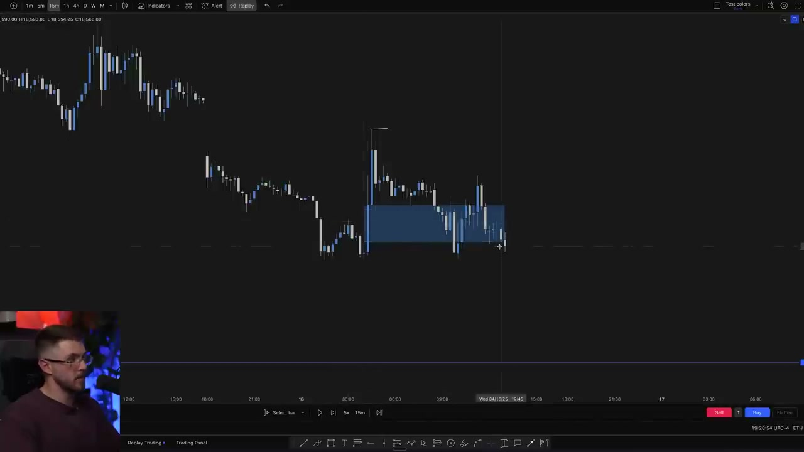

*视频截图｜[34:36](https://www.youtube.com/watch?v=HC2iUkI8Dh8&t=2076s)：蓝色矩形原本是缺口，后续蜡烛反向穿过后，原有承接意义发生改变。*

### 5.4 Price Delivery 与收盘实体

作者用连续收盘蜡烛判断“价格正在向哪一侧交付”：

- 如果下降收盘实体不断吞没上升收盘实体，价格偏向向下交付；
- 如果来到关键位置后，上升收盘实体反过来吞没下降实体，则可能转为向上交付。

技巧：

- 可以隐藏影线，只看蜡烛实体；
- 成交量主要分布在实体区域，实体被反向吞没时，许多仓位进入浮亏；
- 浮亏交易者回补，会反过来强化新方向。

同样，这种“收盘实体转换”只在关键位置附近更值得关注。

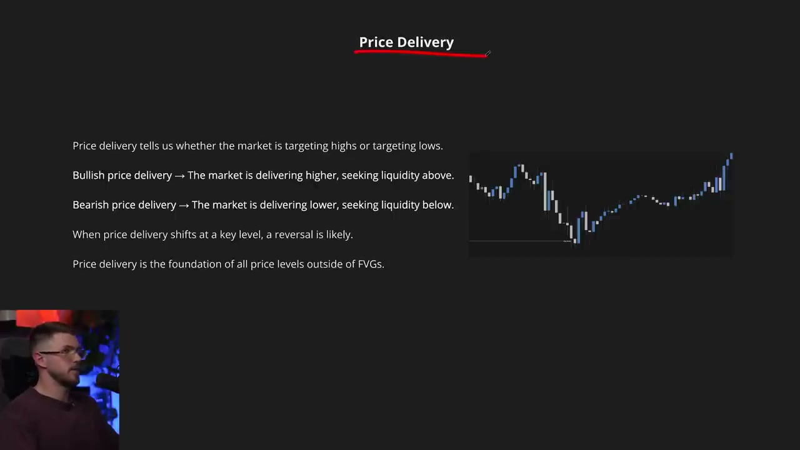

*视频截图｜[36:08](https://www.youtube.com/watch?v=HC2iUkI8Dh8&t=2168s)：价格交付回答的是“当前在找上方还是下方流动性”，不是单独的买卖按钮。*

### 5.5 Order Block（订单块）

作者的定义：

- 价格有力改变交付方向；
- 离开前最后一根反向蜡烛形成区域；
- 若后续伴随位移并产生 FVG，优先级更高；
- 若订单块出现在关键位置，再考虑交易。

在偏空环境：

- 上涨收盘蜡烛可作为阻力区；
- 价格回到该区域后若出现向下确认，可寻找空单。

在偏多环境：

- 下跌收盘蜡烛可作为支撑区；
- 价格回到该区域后若出现向上确认，可寻找多单。

作者强调：**不要交易看到的每一个订单块。**

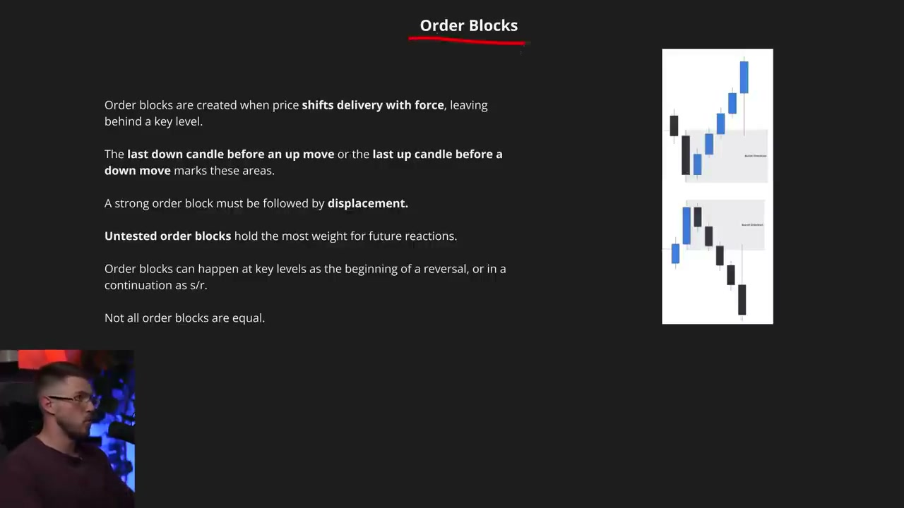

*视频截图｜[39:18](https://www.youtube.com/watch?v=HC2iUkI8Dh8&t=2358s)：右侧示意强调反转前最后一根反向蜡烛，并要求后续推力与位移。*

### 5.6 时间流动性

这是作者用来过滤大量主观高低点的方法。

重点是：

- 前一交易日高/低；
- 前一周高/低；
- 作者定义的亚洲与伦敦时段高/低；
- 已经取用与尚未取用的位置；
- 1H、4H、日线的摆动点与 FVG；
- 相等高低点、趋势线、整数关口。

“未被取用”比“图上很显眼”更重要。一个再漂亮的位置，若已经被穿过，就不能继续当作同一方向的关键反应位。

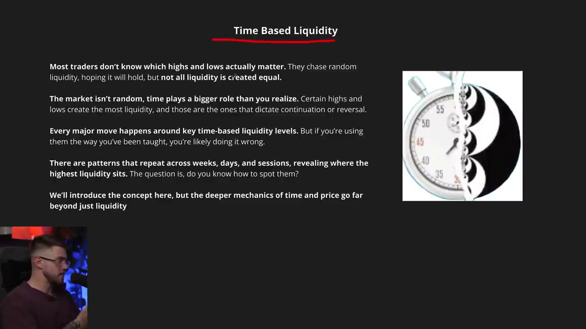

*视频截图｜[40:46](https://www.youtube.com/watch?v=HC2iUkI8Dh8&t=2446s)：作者提出用周、日与时段重复性来机械过滤“哪些高低点值得看”。*

---

## 6. SMT 背离：用相关市场寻找不同步

SMT 全称 Smart Money Technique。作者用它观察两个相关市场是否在同一位点给出不同反应。

### 6.1 同向相关市场

例如 NQ、ES、YM 通常同向。

看低点时：

- NQ 形成更高的低点；
- ES 形成更低的低点；
- 两者没有同步；
- 若出现在关键位置，作者倾向认为较低低点可能是清扫，市场更容易向上。

看高点时：

- 一个指数形成更高高点；
- 另一个只形成更低高点；
- 若其他条件支持向下，可作为偏空汇合。

### 6.2 反向相关市场

例如 EUR/USD 与 DXY 通常反向。

如果相关性突然破裂，也可能说明某一市场正在被快速重新定价。

### 6.3 使用限制

作者明确说：

- SMT 是补充 confluence；
- 关键不是看到背离，而是知道它出现在**何处、何时**；
- 若两个市场都有机会，他倾向于选择结构更清晰、交易设置更好的那个。

不要把任何两次高低点不同步都叫 SMT；它需要相关市场、同一时间段、关键位置和后续确认。

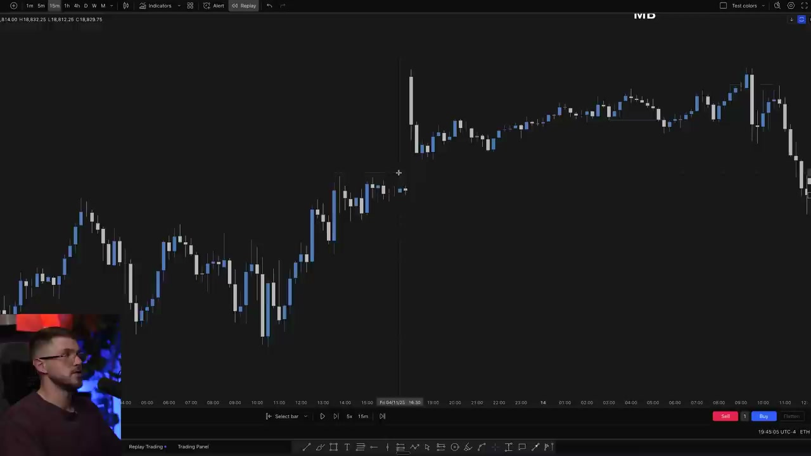

*视频截图｜[42:07](https://www.youtube.com/watch?v=HC2iUkI8Dh8&t=2527s)：同一时间窗内对比相关市场，寻找一端扫掉前高/低、另一端没有同步的情形。*

---

## 7. Market Maker Model：把高周期一笔行情拆成低周期路径

作者刻意反对把 Market Maker Model 神秘化。他的简化版本是：

1. 高周期价格进入关键位置；
2. 切到低周期；
3. 观察回撤或盘整中的假突破；
4. 等流动性被扫后出现 Change in State of Delivery；
5. 确认自己站在同一段行情的正确一侧；
6. 持有到下一个内部或外部流动性目标。

### 7.1 为什么有用

- 避免看到一次回撤就反手；
- 知道中继盘整可能是趋势继续前的清扫；
- 敢于在回撤后加仓或移动止损；
- 避免在同一段行情里频繁进出。

### 7.2 多周期对齐

视频示例使用了：

- Weekly → 4H；
- 4H → 15M；
- 15M → 1M。

这不是固定公式，而是“大周期给位置，小周期给执行”的逐级放大。

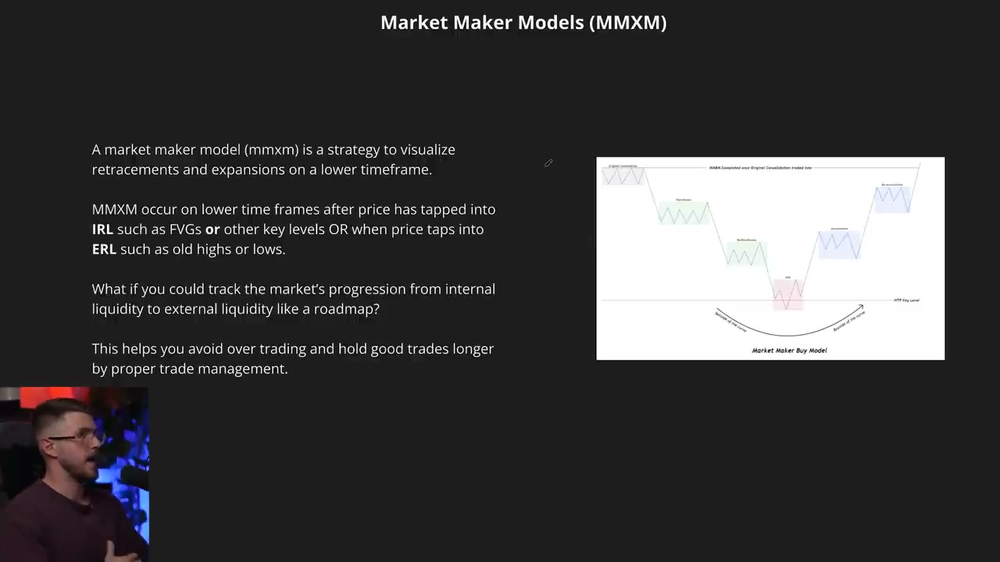

*视频截图｜[45:07](https://www.youtube.com/watch?v=HC2iUkI8Dh8&t=2707s)：低周期回撤、再分配、清扫与扩张被画成一条可分段管理的路径。*

---

## 8. 交易系统：SOP 比“看对方向”更重要

作者把盈利拆成两个不同部件：

### 8.1 Standard Operating Procedure（SOP）

包括一切**入场之外**的流程：

- 盘前准备；
- 睡眠与精神状态；
- 宏观/财报检查；
- 标关键位置；
- 单笔和单日风险；
- 连续亏损后的停手规则；
- 记录、复盘与数据筛选；
- Prop Firm 规则。

### 8.2 Mechanical Strategy

负责回答：

- 什么时候允许交易？
- 在哪个位置交易？
- 什么信号触发？
- 止损在哪里？
- 目标在哪里？
- 信号失效后如何处理？

作者认为，没有 SOP 的人即使“有策略”，临场仍会犹豫、过度交易或违反风险规则。

### 8.3 “交易应该变得无聊”

这句话背后不是要消除所有思考，而是把大量判断预先固化：

- 位置由列表决定；
- 触发由规则决定；
- 错误由止损决定；
- 当天亏损上限由账户决定；
- 盘后按数据优化，而不是盘中被情绪优化。

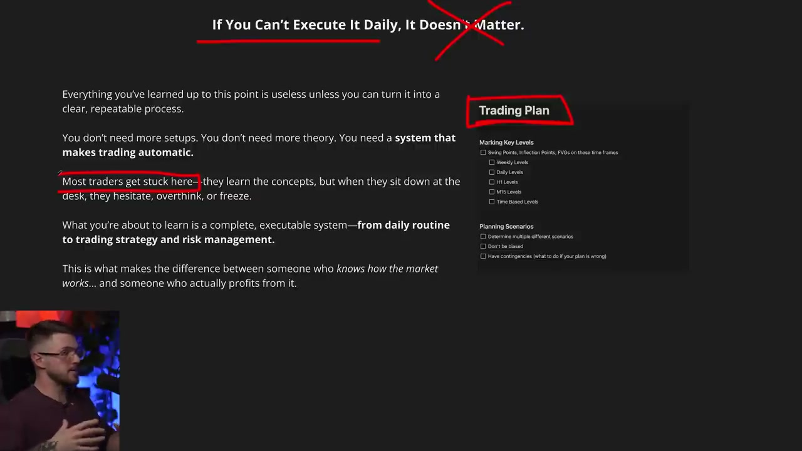

*视频截图｜[52:58](https://www.youtube.com/watch?v=HC2iUkI8Dh8&t=3178s)：幻灯片把 Marking Key Levels、Planning Scenarios、Risk Management 等列为系统组成。*

---

## 9. 盘前、场景规划与新闻风险

### 9.1 盘前流程

作者通常提前约 30 分钟准备：

1. 标出高周期关键价位；
2. 判断当天更可能扩张还是盘整；
3. 检查重大经济事件、财报与 Prop Firm 新闻限制；
4. 确定当天最多可承受多少亏损；
5. 给每个关键位置写出“反转场景”和“失效/Flip 场景”。

作者重视睡眠和固定晨间流程；若状态不佳，他选择不交易。

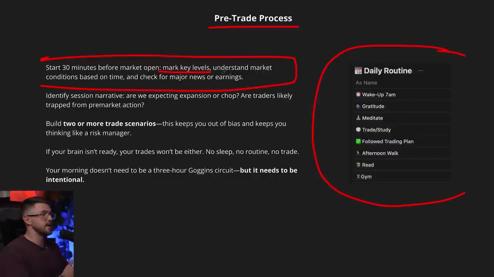

*视频截图｜[56:40](https://www.youtube.com/watch?v=HC2iUkI8Dh8&t=3400s)：开盘前 30 分钟标位置、检查新闻和财报、建立至少两种情景。*

### 9.2 新闻不是一概回避

作者不认同“永远不要交易红文件夹新闻”的绝对说法。

他的实际处理是：

- 不把数据公布当刻当作普通行情；
- 重大数据前不持有普通仓位，避免流动性变薄导致滑点；
- 数据公布后等市场重新形成结构，再按位置交易；
- 有重大事件时可能更积极，但也可能因波动调整仓位。

他特别提到：

- NFP；
- CPI；
- FOMC 利率决议。

视频中的新闻方向解读只是一般化经验，并明确承认不是 100% 规律；不要拿新闻标题直接替代价格确认。

### 9.3 Prop Firm 特有限制

不同公司的规则可能包括：

- 新闻窗口禁止开仓或持仓；
- 每日最大亏损；
- 最大回撤；
- 单一持仓与总持仓限制；
- 隔夜/周末持仓限制。

**规则以账户合同和当期官方说明为准，不能使用视频中的泛化经验代替。**

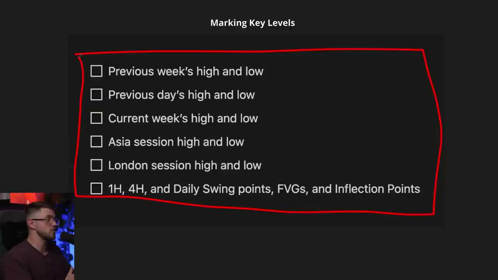

*视频截图｜[1:02:18](https://www.youtube.com/watch?v=HC2iUkI8Dh8&t=3738s)：前一周、前一日、当前周、亚洲与伦敦时段高低，以及 1H/4H/日线的 Swing、FVG 和 IP。*

---

## 10. 确认、反转与 Flip

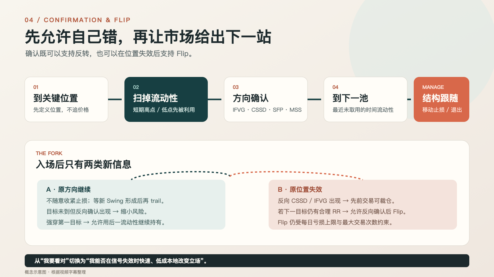

### 10.1 确认不是“预测一定发生”

确认只表示：

- 价格已来到预先标记的关键位置；
- 对方流动性先被取用；
- 随后价格用可定义的方式朝预期方向交付；
- 若该行为失败，何时能明确认定自己错了。

### 10.2 Reversal 与 Flip

**Reversal：**

- 关键位置触达；
- 流动性清扫；
- 出现 IFVG、价格交付转换或结构位移；
- 价格从原方向反向走。

**Flip：**

- 本以为某关键位置会守住；
- 入场后价格又用反向确认否定该位置；
- 不执着于原方向，承认该位置失效；
- 朝列表中的下一个关键位置重新交易。

作者把 Flip 看成新信息，而不是“连续亏损”或“报复交易”。但实际操作必须仍受单日最大亏损限制。

### 10.3 Market Structure Shift

最传统的确认方式是：

1. 价格来到关键位置；
2. 反向推动并取得流动性；
3. 形成位移；
4. 突破短期结构并留下 FVG；
5. 朝新方向寻找入场。

### 10.4 更早的确认线索

作者列举了四个较早可能出现的行为：

1. **Swing Failure Pattern（SFP）**：试探前高/前低，但无法有效收在其外；
2. **Inverted FVG**：原先 FVG 被反向收盘穿透；
3. **Change in State of Delivery**：收盘实体的多空主导权反转；
4. **Unicorn**：价格交付转换、订单块与 FVG 等发生在同一区域。

这些是线索，不是四个必须全部出现的神奇按钮。越早的信号需要越强的位置与语境过滤。

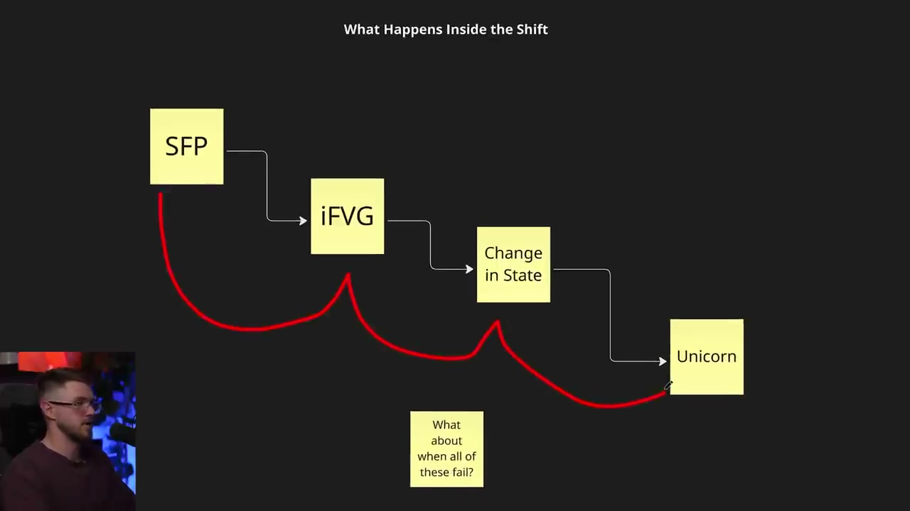

*视频截图｜[1:16:24](https://www.youtube.com/watch?v=HC2iUkI8Dh8&t=4584s)：作者把更早的确认线索串成一条路径，并特别追问“如果这些全部失败怎么办”。*

---

## 11. 风险管理

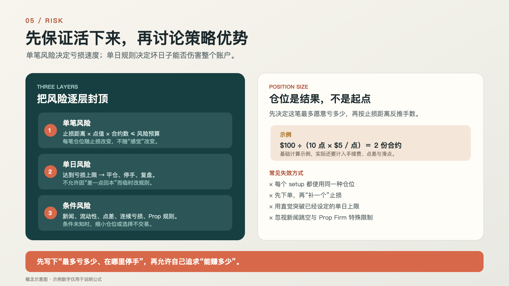

### 11.1 两根支柱

1. **Position Sizing：一笔最多亏多少。**
2. **Rules：一天最多亏多少、什么时候停手。**

两者缺一不可。

### 11.2 作者的三阶段说法

**初学者：**

- 首要目标不是赚钱，而是存活和建立数据；
- 使用最小仓位，单笔风险保持固定；
- 先把流程、记录和失效条件做稳定。

**中级：**

- 开始根据设置质量调整仓位；
- 多周期一致、关键位置清晰、确认更多时，可略大；
- 单一确认、环境矛盾时，缩小或跳过。

**熟练后：**

- 用数据和经验调整风险；
- 仍然保留硬性单日上限；
- 不使用“有直觉”作为突破风险纪律的理由。

这些层级是作者的框架，不是风险推荐。

### 11.3 一个基础仓位计算方式（补充）

可以用下面的通用公式代替“背固定手数”：

```text
合约数 = 可承受亏损金额 ÷（止损距离 × 每点价值）
```

示例：

- 账户风险预算：$100；
- 止损距离：10 点；
- 每点价值：$5；
- 最大合约数：$100 ÷ (10 × $5) = 2。

还要计入手续费、点差、隔夜费与实际滑点。

### 11.4 连续亏损

作者强调：

- 连亏是正常现象；
- 即使是高胜率策略，也可能出现多次连亏；
- 关键是用单日亏损上限与停手规则保护账户；
- 他个人不喜欢在一天内承受超过两次亏损，但这是他的偏好，不是普适定律。

视频用二项分布图说明连亏概率，但没有给出完整数据假设。真实交易结果也可能有相关性、波动聚集与策略失效，不能把某个固定“93%”当作普遍常数。

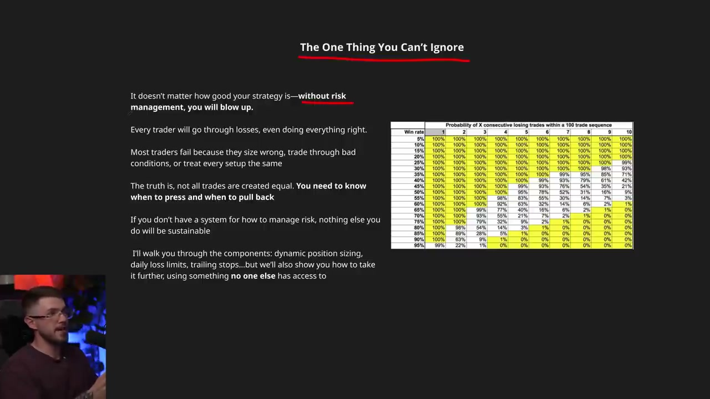

*视频截图｜[1:25:28](https://www.youtube.com/watch?v=HC2iUkI8Dh8&t=5128s)：左侧强调没有风控终将爆仓，右侧展示作者使用的连续亏损概率表。*

### 11.5 复盘应回答的问题

作者认为单纯记录盈亏没有足够价值。应该筛选：

- 哪个时段盈利/亏损；
- 哪类 setup 的期望更好；
- 反转单和 Flip 单分别表现如何；
- 单笔 R 倍数；
- 最大有利/不利 excursion；
- 盈利单若按价格加权，原本还能多跑多少；
- 是否因主观 daily bias 错过或做大错误交易。

---

## 12. 作者的 All-in-One 机械交易流程

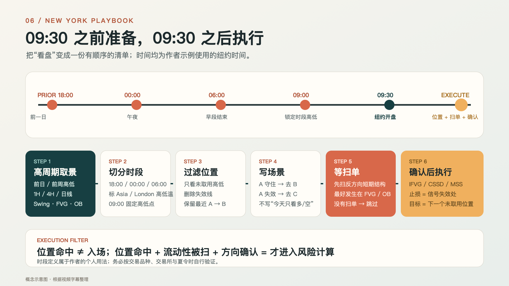

> 以下内容复述作者在 1:32 后的完整流程。时间和标记方式来自视频；实盘前必须根据品种、平台、夏令时、Prop Firm 规则和自身数据验证。

### Step 1｜标高周期位置

1. 日线：前一交易日高、低。
2. 周线：前一周高、低。
3. 1H/4H/日线：相关摆动点、FVG、订单块。
4. 只把仍可能影响当日价格的位置保留下来，清理已经失效的线。

### Step 2｜用纽约时间划分隔夜区间

作者的视频流程：

1. 打开 15 分钟图；
2. 在纽约时间：
   - 前一日 18:00；
   - 当日 00:00；
   - 当日 06:00；
3. 画出三条竖线；
4. 标出作者所称亚洲、伦敦时段的高低点；
5. 到 09:00 才最终固定这些隔夜高低点。

需要特别说明：

- 这是作者自己使用的时段划分，不等于所有 ICT 教程统一的 Asia/London 时段；
- 注意纽约夏令时与冬令时；
- 视频没有把所有品种的时段定义详细展开，不应把这三条线当成市场定律。

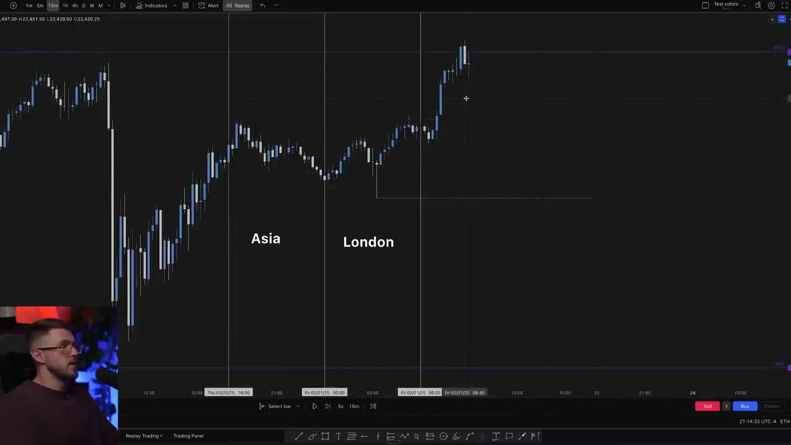

*视频截图｜[1:33:20](https://www.youtube.com/watch?v=HC2iUkI8Dh8&t=5600s)：画面直接展示了作者在 15 分钟图上放置时段分界线的做法。*

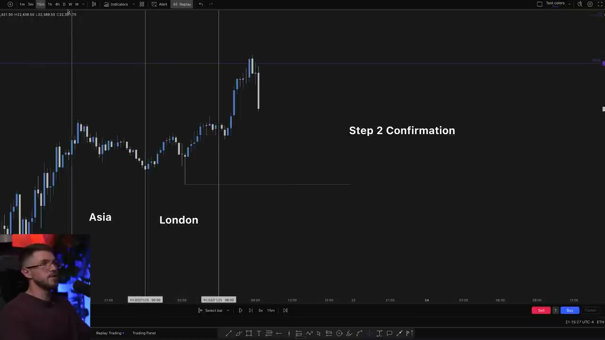

*视频截图｜[1:34:10](https://www.youtube.com/watch?v=HC2iUkI8Dh8&t=5650s)：进入执行前，先确认价格从关键位置朝向下一未取用位置运行。*

### Step 3｜09:00 筛选“未取用”位置

不要把所有线都当成有效：

- 已经被交易到的位置，降低或取消优先级；
- 优先关注尚未触碰的高/低；
- 把当前价格最接近、且仍有意义的两侧位置作为目标候选。

### Step 4｜09:30 前只观察，不执行

作者规则：

- 纽约开盘前即使出现漂亮信号，也不交易；
- 09:30 后，市场从关键位置开始交付，才进入执行窗口；
- 错过盘前第一段不代表错过当天，未取用的位置仍可能提供机会。

### Step 5｜形成“从 A 到 B”的场景

例如：

- 价格若在前日高遇到拒绝，目标 = 最近的伦敦低；
- 价格若假突破前日高后向上交付，目标 = 更上方的未取用位置；
- 价格若在伦敦低反转，目标 = 最近的亚洲高；
- 价格若令伦敦低失效，目标 = 下一个下方位置。

不是只写一个方向，而是写：

> 若市场在 A 出现 X，则做多/做空到 B；若出现 Y，则翻转到 C。

### Step 6｜到位置后等“流动性扫单＋确认”

作者要求至少看到：

1. 价格来到关键位置；
2. 短期结构先朝不利方向被扫掉；
3. 随后出现：
   - IFVG，或
   - 价格交付转换，或
   - 更完整的 Market Structure Shift。
4. 最好确认发生在 FVG/订单块内。

没有“run on liquidity”，不追第一根反向蜡烛。

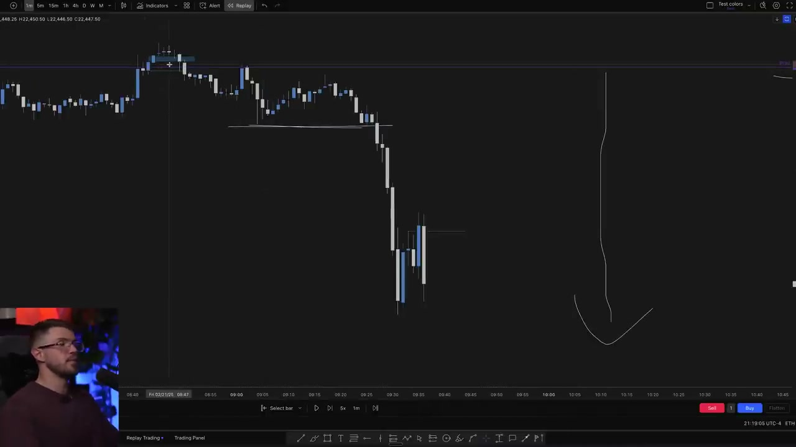

*视频截图｜[1:37:20](https://www.youtube.com/watch?v=HC2iUkI8Dh8&t=5840s)：价格先扫短期结构，再出现向下收盘与位移；画面右侧标出了下一个目标逻辑。*

### 入场、止损与目标

**空单示例：**

- 前提：大方向偏向从高点走向低点；
- 价格扫过短期高点；
- 向下收盘实体吞没上涨实体或形成 IFVG；
- 在确认后卖出；
- 止损放在最近高点、失真的实体上沿或更宽的摆动高点；
- 目标设为下一个未取用时间流动性。

**多单示例：**

- 价格扫过短期低点；
- 向上收盘实体吞没下降实体；
- 在确认后买入；
- 止损放在最近摆动低点或实体下沿；
- 目标设为最近的未取用高点。

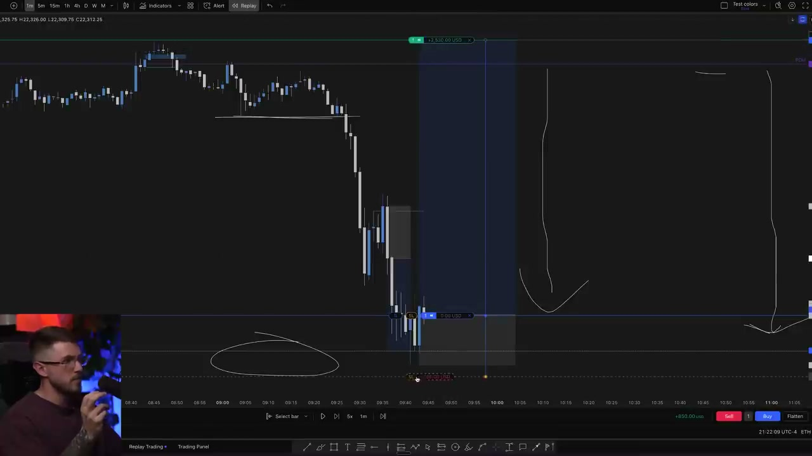

*视频截图｜[1:39:55](https://www.youtube.com/watch?v=HC2iUkI8Dh8&t=5995s)：画面同时展示了入场、止损、目标区域与浮动盈亏标记，体现作者如何把位置和风险放进同一笔交易。*

### 止损宽窄怎样权衡

作者的做法：

- 交易“两个关键位置之间”的中继行情时，止损更紧，使用实体或最近小摆动；
- 交易大关键位置的第一次反转型交易时，允许更大空间，用完整摆动点；
- 他不追求所有交易固定止损点，而追求固定“账户风险金额”。

### 失效后怎么办

如果入场后出现反向的 delivery change 或 IFVG：

1. 先承认当前位置可能失效；
2. 可以按入场价附近裁掉；
3. 若下一位置仍有足够风险回报，可按反向确认交易；
4. 反向交易不是报复，而是基于新目标和新的可证伪信号；
5. 仍必须满足当天最大亏损与最大交易次数规则。

---

## 13. 目标位与 Price Weighting：让盈利单继续跑

作者把“到关键位置就全平”改成两步：

1. 到达第一个关键位置时，先评估反应；
2. 若价格仍强势突破该位置，使用摆动高低点持续移动止损；
3. 让止损成为实际止盈线。

### 13.1 空单移动止损

- 价格向下走；
- 每次反弹形成新的 Swing High，然后再次向下突破；
- 把止损向下移到该 Swing High 上方；
- 不在“目标价”机械平仓，除非出现明确反向确认。

### 13.2 多单移动止损

- 价格向上走；
- 每次回撤形成新的 Swing Low，然后再次向上突破；
- 把止损向上移到该 Swing Low 下方；
- 用下一轮向上结构继续管理。

### 13.3 适用条件

这并不是“所有盈利单永不封顶”：

- 需要明显扩张环境；
- 需要在关键位置出现反应；
- 需要低周期结构持续同向；
- 当日波动不足、接近重要反向位置时仍可主动止盈。

作者称这种方法为 Price Weighting，但本质上是**以市场结构为基础的移动止损 / trailing stop**。视频中举了一个约 5R 的交易，通过持续跟随结构最终做到约 8R。

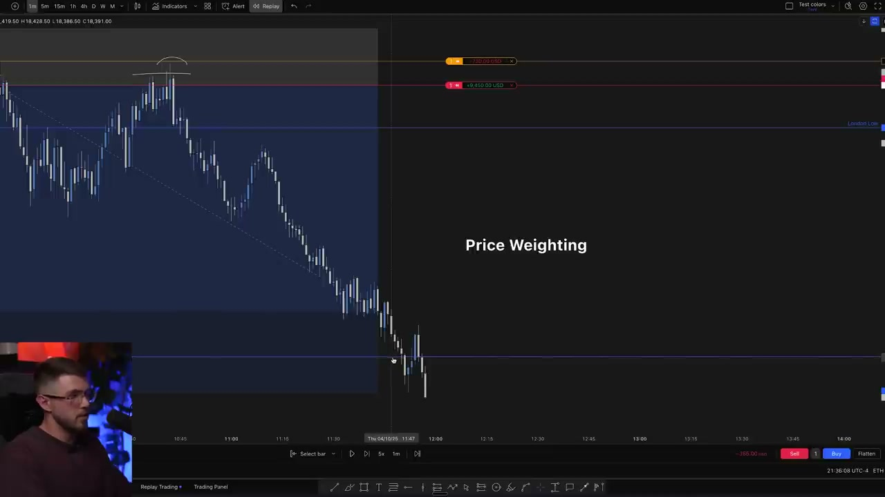

*视频截图｜[1:51:24](https://www.youtube.com/watch?v=HC2iUkI8Dh8&t=6684s)：价格持续延续时，作者没有在第一个目标机械全平，而是让止损跟随新结构推进。*

---

## 14. 交易心理与长期进步

### 14.1 作者反对的思维

- 必须今天就证明自己；
- 必须用交易向家人证明；
- 输了就是策略没用；
- 方向错了仍坚持“有纪律地”扛单；
- 把握住每一个行情；
- 把正常亏损解释成个人失败。

### 14.2 作者建议的思维

- 把重要性从“今天必须赚钱”降到“今天是否按流程做对”；
- 错误的位置失效后，把它视为市场提供的新信息；
- 复盘结果，但在盘中止盈/止损依据规则；
- 接受账户、连续亏损和策略回撤可能发生；
- 先把流程做好，再期待收益。

### 14.3 为什么需要记录“无 bias” vs “有 bias”

作者称自己回顾 400 多笔交易后发现：

- 有 daily bias 时，胜率约 55%；
- 没有强方向 bias 时，胜率接近 70%；
- 去掉 bias 后 profit factor 提高。

这些数字来自作者个人、自报且未公开完整样本和计算方法，因此只能作为提醒：

> **记录“主观预设立场”是否会让你过滤相反证据、放大仓位或造成持有偏差。**

不能据此推出“所有交易者取消偏见都会提高胜率”。

---

## 15. 一页速查表

### 盘前

- [ ] 前一交易日高/低
- [ ] 前一周高/低
- [ ] 作者定义的隔夜亚洲/伦敦高低点
- [ ] 1H/4H/日线 Swing、FVG、OB
- [ ] 清理已经取用的位置
- [ ] 检查重大新闻、财报与 Prop Firm 限制
- [ ] 写至少两个场景：关键位置守住做什么，失效后做什么
- [ ] 定义今日最大亏损与最大交易次数

### 到位置后

- [ ] 先确认价格真正进入关键位置，而不是凭“接近”
- [ ] 找短期流动性被扫
- [ ] 确认所在位置有清晰目标（下一内部/外部流动性）
- [ ] 等 IFVG、delivery change、MSS 或 SFP 后确认
- [ ] 计算止损到目标的实际 RR，并计入滑点与成本
- [ ] 没有信号就跳过；允许整天不交易

### 入场后

- [ ] 止损放在“信号失效就证明我错”的位置
- [ ] 第一目标 = 最近未取用关键位置
- [ ] 触及目标后观察反应
- [ ] 若强突破目标，则按摆动高低点移动止损
- [ ] 出现反向确认时缩小风险或 Flip
- [ ] 触发单日亏损上限立即停止

### 最容易犯的三个错误

1. 把每个 FVG、订单块、扫高低点都当成设置；
2. 有位置但没有确认就入场，或有确认但位置没意义；
3. 用了“反转/Flip”概念，却没有硬性风险上限。

---

## 16. 术语表

| 英文 | 中文 | 视频中的实用含义 |
|---|---|---|
| ICT | Inner Circle Trader | 以流动性、时间、价格交付为核心的一套价格行为体系 |
| Liquidity | 流动性 | 明高点上方或明低点下方聚集的止损单、突破单 |
| Buy-side Liquidity | 买方流动性 | 高点上方，空头止损与追多单聚集 |
| Sell-side Liquidity | 卖方流动性 | 低点下方，多头止损与追空单聚集 |
| Displacement | 位移 | 有力、连续、常留下 FVG 的单边推动 |
| Manipulation | 操纵 | 扫掉高低点后快速收回，未形成有效延续 |
| FVG | 公允价值缺口 | 三根蜡烛推动之间的价格失衡区 |
| BOS Gap | 结构突破缺口 | 一口气突破多段结构的大 FVG |
| IFVG | 倒置 FVG | FVG 被反向收盘穿透，承接失败 |
| OB / Order Block | 订单块 | 转向位移前最后一根反向蜡烛的区域 |
| IRL | 内部流动性 | 区间内部、特别是 FVG |
| ERL | 外部流动性 | 区间外部的摆动高低点 |
| Premium | 溢价区 | 有效区间 0.5 以上 |
| Discount | 折价区 | 有效区间 0.5 以下 |
| SMT | 聪明钱背离 | 相关市场在同一高低点出现不同步反应 |
| SFP | 摆动失败 | 试探高低点但未有效收在其外 |
| CSSD | 价格交付状态改变 | 收盘实体的主导方向反转 |
| MSS | 市场结构转换 | 位移取得流动性并反转短期结构 |
| Market Maker Model | 做市商模型 | 高周期关键位置在低周期形成清扫—转向—扩张路径 |
| Flip | 翻转交易 | 原关键位置失效后，按反向确认去下一位置 |
| Price Weighting | 价格加权 | 视频用法：到达目标后按摆动点移动止损 |


---

## 最后，用六句话记住全片

1. 市场最值得观察的不是“图形名字”，而是明显高低点附近的订单。
2. 突破若没有位移与失衡，优先怀疑清扫。
3. FVG、订单块、SMT 和 MSS 只是位置与确认的语言，不能脱离语境使用。
4. 高周期负责“去哪里”，低周期负责“何时、在哪里执行”。
5. 关键位置出现确认才做；位置失效时，目标切换到下一个位置。
6. 单笔风险、单日亏损、记录和复盘，决定这套方法能否长期存活。
